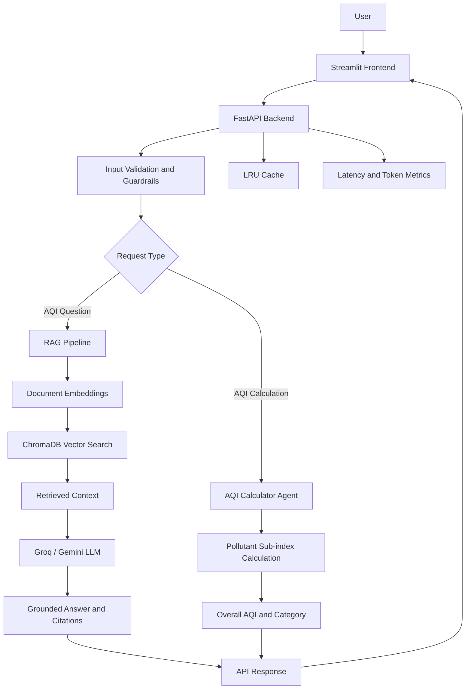
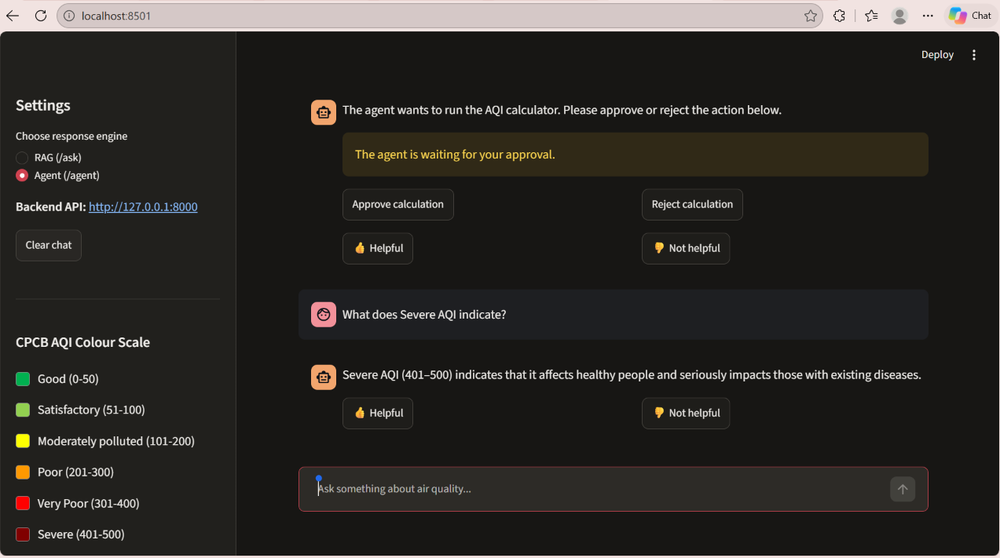

# AQIExplainer - GenAI-Based Air Quality Analysis System

## 1. Project Overview

AQIExplainer is a Python-based Generative AI application designed to help users understand Air Quality Index (AQI) information across different cities in Maharashtra.

The project combines data processing, traditional search, Large Language Models (LLMs), semantic search, document retrieval, Retrieval-Augmented Generation (RAG), and agentic AI to make air quality information easier to access and understand.

**The project provides:**

- City-wise AQI values and air quality categories.
- Prominent pollutants and monitoring station information.
- Searchable and structured AQI records.
- AI-powered AQI question answering.
- Document-based information retrieval.
- Semantic search using vector embeddings.
- RAG-based answers with source citations.
- Pollutant-based AQI calculations.
- Agent-based question routing and human approval.
- Interactive conversational interface.
- Request monitoring, caching, and input safety features.

## 2. Problem Statement

Air pollution is a major environmental concern. Although AQI information is publicly available, many people find it difficult to understand AQI values, their categories, and the pollutants responsible for air quality conditions.

AQIExplainer aims to:

- Organize air quality information into structured records.
- Make AQI data easier to understand.
- Help users search for city-wise air quality information.
- Generate understandable answers to AQI-related questions.
- Retrieve relevant information from AQI documents.
- Provide source-grounded answers with references.
- Calculate AQI sub-indices from pollutant concentrations.
- Improve awareness about environmental pollution.

## 3. Product Description

AQIExplainer is an AI-powered Air Quality Information and Explanation System.

It processes AQI datasets and documents, retrieves relevant information using semantic search, and generates contextual answers using LLMs.

The system also includes an AQI calculator and agent workflow that can route calculation-related questions to the appropriate tool and request human approval before calculator execution.

## 4. Target Users

- General public.
- Students.
- Researchers.
- People interested in air pollution and environmental awareness.

## 5. Data Sources

### Central Pollution Control Board (CPCB), India

- Organization: Central Pollution Control Board.
- Website: https://cpcb.nic.in/
- Data Type: Daily Air Quality Index (AQI) Bulletins.
- Coverage: Different cities across Maharashtra.
- Bulletin Date: 06 November 2026.
- Bulletin Time: 4 PM.
- Dataset: 20 Maharashtra city AQI records.

**Official Bulletin:**

https://cpcb.nic.in/National-Air-Quality-Index/

### Additional Raw Data

- Raw pollutant measurement data downloaded from the Maharashtra Pollution Control Board (MPCB) source.
- Includes pollutant measurements such as PM2.5, PM10, NO2, SO2 and CO.
- Original downloaded files are stored in `data/raw/`.

## 6. Technologies Used

### Programming and Backend
- Python
- FastAPI
- Uvicorn
- Python Dataclasses
- Exception Handling

### Data Processing and Search
- CSV and JSON
- Pandas
- Scikit-learn
- TF-IDF Vectorization
- Cosine Similarity
- PyPDF

### Generative AI and Retrieval
- Large Language Models (LLMs)
- Groq API
- Google Gemini API
- Prompt Engineering
- Embeddings
- ChromaDB
- Semantic Search
- Document Chunking
- Retrieval-Augmented Generation (RAG)
- Source-based Citations

### Agentic AI
- Rule-Based Agent
- LangGraph
- Conditional Routing
- Human-in-the-Loop Approval
- Conversation State Management
- MemorySaver Checkpointing

### Frontend
- Streamlit
- Streamlit Session State
- Conversational Chat Interface

### Production Readiness and Testing
- Pytest
- Ruff
- LRU Cache
- Time-to-Live (TTL) Cache
- Request Latency Logging
- Token Usage Tracking
- Input Validation
- Prompt-Injection Screening

### Development Tools
- Git and GitHub
- Visual Studio Code
- Python Virtual Environment
- Python-dotenv
- Swagger UI

## 7. Main Features

- Display AQI information for Maharashtra cities.
- Search AQI records using city names or keywords.
- Count cities according to AQI categories.
- Retrieve records using unique IDs.
- Process and clean raw AQI data.
- Store processed AQI records in JSON format.
- Download AQI-related documents.
- Generate natural-language answers using LLMs.
- Support Groq and Gemini as LLM providers.
- Extract text from PDF, CSV and JSON documents.
- Split documents into smaller overlapping text chunks while preserving metadata.
- Generate embeddings for document chunks.
- Store document embeddings in a persistent ChromaDB vector database.
- Retrieve relevant document chunks through semantic search.
- Generate RAG-based answers using retrieved document context.
- Provide source references with generated answers.
- Return "I don't know" when requested historical information is unavailable.
- Evaluate retrieval performance using predefined AQI questions and different configurations.
- Calculate AQI sub-indices using pollutant concentrations.
- Identify the dominant pollutant.
- Route user requests using a rule-based agent.
- Execute RAG and calculator workflows using LangGraph.
- Request human approval before calculator execution.
- Provide an interactive Streamlit chat interface.
- Display source citations and conversation history.
- Collect thumbs-up and thumbs-down user feedback.
- Display a six-category CPCB AQI colour indicator with health-impact statements.
- Cache repeated RAG questions.
- Log request latency and token usage for `/ask`.
- Apply question-length and retrieval-limit validation.
- Screen common prompt-injection patterns.

## 8. Project Structure

```text
Gen-AI-Examate/
│
├── README.md
├── requirements.txt
├── .gitignore
├── .env.example
├── ruff.toml
│
├── analysis/
│   └── explore.py
│
├── data/
│   ├── raw/
│   ├── sample_records.py
│   ├── records.json
│   └── chroma/
│
├── docs/
│   ├── how_llms_work.md
│   ├── user_questions.md
│   ├── checkpoint-2.png
│   └── resume.md
│
├── eval/
│   ├── eval_set.json
│   ├── run_eval.py
│   ├── run_search_eval.py
│   ├── results.json
│   ├── results.md
│   ├── search_results.md
│   └── prompt_compare.md
│
├── app/
│   ├── __init__.py
│   ├── records.py
│   ├── cli.py
│   ├── models.py
│   ├── ingest.py
│   ├── fetch.py
│   ├── main.py
│   ├── smart_search.py
│   ├── llm.py
│   ├── chunking.py
│   ├── embed.py
│   ├── vectorstore.py
│   ├── rag.py
│   ├── tools.py
│   ├── agent_loop.py
│   ├── graph.py
│   └── guardrails.py
│
├── tests/
│   ├── conftest.py
│   ├── test_health.py
│   ├── test_records.py
│   ├── test_search.py
│   ├── test_ask.py
│   ├── test_agent.py
│   └── test_guardrails.py
│
├── logs/
│   └── requests.jsonl
│
└── ui/
    └── app.py
```

Note: The structure above describes the main project components. Some folders and files, such as `logs/requests.jsonl` and `docs/resume.md`, are generated or added during development. Local ChromaDB data and environment files should not be committed to GitHub.

## 9. Project Development Journey

### Day 1 – Python Fundamentals

- Created the project introduction.
- Developed a menu-based application.
- Practised Python variables and data types.
- Used f-strings and input().
- Implemented while loops and conditional statements.
- Practised basic Python programming and control flow.

### Day 2 – AQI Dataset and Search

- Created a Maharashtra AQI dataset containing 20 city records.
- Implemented keyword searching.
- Implemented AQI category counting.
- Added record retrieval functionality.
- Developed a command-line interface.
- Organized AQI information into structured records.

### Day 3 – Data Ingestion and Processing

- Downloaded the CPCB AQI bulletin and raw pollutant data.
- Created `app/ingest.py` for CSV reading, data cleaning and validation.
- Generated structured AQI records in `data/records.json`.
- Created `app/models.py` using Python dataclasses.
- Developed `app/fetch.py` for downloading documents using the Requests library.
- Practised exception handling and invalid-data management.

### Day 4 – API Development and Smart Search

**S1: FastAPI Service**

- Created a FastAPI application in `app/main.py`.
- Implemented health-check functionality.
- Added an endpoint to retrieve AQI records with a limit parameter.
- Implemented record retrieval by ID with HTTP 404 handling.
- Added an AQI search endpoint.
- Created a POST endpoint for AQI-related questions.

**S2: Data Analysis and Smart Search**

- Created `analysis/explore.py` using Pandas.
- Generated three facts from AQI records.
- Implemented TF-IDF vectorization in `app/smart_search.py`.
- Used cosine similarity to rank matching AQI records.
- Integrated smart search with the FastAPI application.

**Concepts Learned:**

- FastAPI and REST APIs.
- HTTP methods and status codes.
- Pandas.
- TF-IDF.
- Cosine similarity.
- API testing using Swagger UI.

### Day 5 – LLM Fundamentals and Documentation

**S1: Understanding Large Language Models**

- Studied Large Language Model fundamentals.
- Learned how tokenization converts text into smaller tokens.
- Understood embeddings and numerical representations of text.
- Studied Transformer architecture.
- Learned about the self-attention mechanism.
- Understood next-token prediction and response generation.
- Created `docs/how_llms_work.md` with a workflow diagram.

**S2: AQIExplainer User Questions**

- Created `docs/user_questions.md`.
- Added 10 realistic questions based on AQIExplainer functionality.
- Identified questions that can and cannot be answered using the current dataset.
- Included a historical AQI question requiring 30 days of data, which is not currently available.

**Checkpoint 1**

- Successfully ran the FastAPI application.
- Verified API endpoints using Swagger UI.
- Tested AQI record retrieval, search and question-answering functionality.
- Created the Git checkpoint `checkpoint-1`.

**Concepts Learned:**

- LLMs.
- Tokenization and embeddings.
- Transformer architecture.
- Self-attention.
- Next-token prediction.
- Dataset limitations.
- Git checkpoint tagging.

### Day 6 – LLM Integration

**S1: LLM Provider Integration**

- Implemented `app/llm.py` for LLM-based AQI question answering.
- Integrated the Groq API.
- Integrated the Google Gemini API.
- Added environment-variable configuration using Python-dotenv.
- Implemented provider selection through configuration.
- Created prompt-based response generation.
- Added JSON response parsing and error handling.

**S2: AQI Question Answering**

- Connected LLM response generation with AQI records.
- Used project data as context for answering user questions.
- Generated structured responses containing:
  - Answer
  - Confidence
  - Follow-up question
- Tested AQI question answering using Groq.
- Verified the `/chat` API endpoint through FastAPI.

**Concepts Learned:**

- LLM API integration.
- Groq and Gemini.
- Prompt engineering.
- Environment variables.
- JSON response parsing.
- Context-based question answering.
- API integration and testing.

### Day 7 – Document Chunking, Embeddings and Semantic Search

**S1: Document Processing and Chunking**

- Created `app/chunking.py`.
- Implemented text extraction from PDF, CSV and JSON documents.
- Split extracted text into smaller overlapping chunks.
- Preserved document metadata, including:
  - Source
  - Title
  - Page or row number
  - Chunk index
- Successfully generated 61 chunks using the default configuration of 900 characters and 150-character overlap.

**S2: Embeddings and Vector Database**

- Created `app/embed.py` for embedding generation and semantic retrieval.
- Implemented `app/vectorstore.py` using ChromaDB.
- Created a persistent vector collection named `aqi_documents`.
- Generated embeddings and successfully indexed all 61 document chunks.
- Added the `GET /search/semantic` API endpoint in `app/main.py`.
- Created `eval/run_search_eval.py` to evaluate retrieval against 10 AQI questions.
- Prepared `eval/search_results.md` for recording search results.

**Day 7 Status:**

- Document extraction and chunking successfully completed.
- Generated 61 document chunks.
- ChromaDB embedding generation successfully completed.
- Indexed all 61 chunks in the persistent `aqi_documents` collection.
- Verified collection access and document count.
- Prepared the semantic search API and evaluation workflow.

**Concepts Learned:**

- Document chunking.
- Chunk overlap.
- Document metadata.
- Text embeddings.
- Semantic search.
- Vector databases.
- ChromaDB.
- Retrieval evaluation.

### Day 8 – Retrieval-Augmented Generation (RAG) and Evaluation

**S1: RAG Implementation**

- Created `app/rag.py` for Retrieval-Augmented Generation.
- Implemented document retrieval using ChromaDB.
- Retrieved relevant document chunks based on user questions.
- Integrated retrieved context with Groq/Gemini LLM response generation.
- Added source-based citations containing document title, source and page/row information.
- Implemented confidence levels in RAG responses.
- Added `POST /ask` endpoint in `app/main.py`.
- Tested RAG through FastAPI Swagger UI.
- Verified that answerable AQI questions generate document-grounded responses with citations.
- Tested an unavailable historical AQI question and verified that the system returns `I don't know` with low confidence and no citations.

**S2: Retrieval Evaluation**

- Created `eval/eval_set.json` containing 15 AQI evaluation questions.
- Included an unanswerable historical AQI question (Q6).
- Created `eval/run_eval.py` to compare two retrieval configurations.
- Modified `app/chunking.py` to support configurable chunk sizes and overlap.
- Modified `app/vectorstore.py` to support multiple ChromaDB collections.
- Created separate evaluation collections:
  - `aqi_eval_a`
  - `aqi_eval_b`
- Evaluated both configurations using the 15-question dataset.
- Generated evaluation reports in `eval/results.json` and `eval/results.md`.

**Evaluation Configurations**

| Parameter | Configuration A | Configuration B |
|---|---:|---:|
| Chunk Size | 900 | 500 |
| Overlap | 150 | 100 |
| Top-k | 3 | 5 |
| Total Chunks | 61 | 79 |
| Keyword Hits | 14/14 | 14/14 |
| Retrieval Hit Rate | 100% | 100% |
| Mean Similarity | 0.5490 | 0.5191 |

**Winning Configuration: Configuration A**

- Both configurations achieved a 100% keyword-based retrieval hit rate.
- Configuration A achieved a higher mean similarity score of 0.5490 compared with 0.5191 for Configuration B.
- Configuration A was selected based on its higher mean similarity score while maintaining the same keyword hit rate.

**Q6 Abstention Test**

Question: How has the AQI of Pune changed over the last 30 days?

Expected response: `I don't know`

Observed response: `I don't know`

- Confidence: Low
- Citations: None

**Evaluation Method Note:**

Keyword hit rate checks whether at least one expected keyword appears in the retrieved chunks. It is a retrieval relevance proxy and does not establish factual answer accuracy. Mean similarity is used as a supporting comparison metric.

**Concepts Learned:**

- Retrieval-Augmented Generation.
- Context retrieval.
- LLM-based answer generation.
- Source-based citations.
- Retrieval and generation workflows.
- ChromaDB collection management.
- Configurable chunking.
- Top-k retrieval.
- Evaluation datasets.
- Retrieval hit rate and similarity scores.
- Abstention for unavailable information.

### Day 9 – AQI Calculator and Agentic AI

**S1: CPCB-Based AQI Calculator**

- Created `app/tools.py`.
- Implemented pollutant sub-index calculations using CPCB breakpoint interpolation.
- Added support for PM2.5, PM10, NO2, O3, CO, SO2, NH3 and Pb.
- Implemented pollutant value validation.
- Calculated overall AQI using the highest pollutant sub-index.
- Identified the dominant pollutant.
- Added AQI category classification from Good to Severe.

**S2: Rule-Based Agent**

- Created `app/agent_loop.py`.
- Implemented a rule-based agent to identify the type of user request.
- Extracted pollutant values from user questions.
- Routed calculation-related questions to the AQI calculator.
- Routed general AQI questions to the RAG pipeline.

**S3: LangGraph Workflow**

- Created `app/graph.py`.
- Implemented an agent workflow using LangGraph.
- Created separate RAG and calculator nodes.
- Added conditional routing between nodes.
- Implemented human approval before calculator execution.
- Added approval and rejection handling.
- Implemented conversation state using LangGraph's MemorySaver checkpointer.

**Testing**

- Tested RAG-based question answering.
- Tested pollutant-based AQI calculation.
- Verified human approval before calculator execution.
- Tested both approval and rejection workflows.
- Verified that the agent resumes using the same conversation thread.

**Concepts Learned:**

- AQI breakpoint interpolation.
- Pollutant sub-index calculation.
- Rule-based agent routing.
- LangGraph state management.
- Conditional edges and workflow execution.
- Human-in-the-loop approval.
- Conversation checkpointing.

### Day 10 – Advanced Evaluation and Streamlit Interface

**S1: Retrieval Evaluation and A/B Comparison**

- Improved retrieval evaluation using a 15-question AQI evaluation dataset.
- Compared two retrieval configurations.
- Evaluated keyword hit rate, Precision@K, Recall@K, Mean Reciprocal Rank (MRR) and mean similarity.
- Compared chunk sizes, overlap and top-k retrieval values.

**Evaluation Configurations**

| Parameter | Configuration A | Configuration B |
|---|---:|---:|
| Chunk Size | 900 | 500 |
| Overlap | 150 | 100 |
| Top K | 3 | 5 |

**Evaluation Results**

| Metric | Configuration A | Configuration B |
|---|---:|---:|
| Keyword Hit Rate | 100% | 100% |
| Precision@K | 0.9286 | 0.8571 |
| Recall@K | 0.7500 | 0.7738 |
| MRR | 0.9524 | 0.9464 |
| Mean Similarity | 0.5490 | 0.5191 |

**Observations**

- Configuration A achieved better Precision@K, MRR and mean similarity.
- Configuration B achieved slightly better Recall@K.
- Both configurations achieved a 100% keyword hit rate.
- Configuration A performed better on precision-oriented metrics, while Configuration B retrieved a slightly broader set of relevant chunks.

**Evaluation Note:** These are preliminary retrieval metrics based on keyword matching and similarity. They do not independently establish factual answer correctness or citation support.

**S2: Streamlit Conversational Interface**

- Created `ui/app.py`.
- Developed an interactive chat interface using Streamlit.
- Connected the frontend to the FastAPI backend.
- Added RAG interaction through the `/ask` endpoint.
- Added LangGraph agent interaction through the `/agent` endpoint.
- Displayed generated answers and source citations.
- Implemented conversation history using Streamlit session state.
- Added thumbs-up and thumbs-down feedback.
- Stored user feedback locally in JSONL format.
- Added controls for human approval and rejection of calculator execution.

**S3: AQI Colour Indicator**

Implemented a six-category AQI colour indicator based on the CPCB AQI scale.

| AQI Range | Category | Colour |
|---|---|---|
| 0–50 | Good | Green |
| 51–100 | Satisfactory | Light Green |
| 101–200 | Moderately Polluted | Yellow |
| 201–300 | Poor | Orange |
| 301–400 | Very Poor | Red |
| 401–500 | Severe | Maroon |

- Added health-impact statements corresponding to each AQI category.
- Displayed the AQI indicator when an explicit numeric AQI value is available.
- Avoided inventing AQI values when the answer does not contain one.

**Concepts Learned:**

- Retrieval evaluation.
- Precision@K and Recall@K.
- Mean Reciprocal Rank.
- A/B retrieval experiments.
- Streamlit application development.
- Session state and conversational history.
- FastAPI and Streamlit integration.
- User feedback collection.
- AQI classification and visualization.

### Day 11 – Testing and Code Quality

**S1: Automated Testing**

- Created a `tests/` directory using Pytest.
- Added tests for the health endpoint.
- Added tests for AQI records and search functionality.
- Added a test for the `/ask` endpoint using a mocked RAG response.
- Added tests for AQI calculator functionality.
- Tested pollutant validation and AQI category classification.
- Tested agent routing and invalid input handling.
- Used FastAPI TestClient for API endpoint testing.
- Used mocking to avoid real LLM API calls during the `/ask` test.

**S2: Code Quality**

- Configured Ruff for Python linting.
- Used Ruff to identify and correct import-order and code-quality issues.
- Ran the test suite using `python -m pytest tests/ -v`.

**Test Results Recorded**

The initial corrected test suite completed with 16 tests passing and no failures.

**S3: Docker Packaging**

The Day 11 task includes creating a Dockerfile, `.dockerignore` and `docker-compose.yml` to run the FastAPI backend and Streamlit frontend together.

**Status:** Docker deployment files and successful container execution must be verified before marking this section complete.

**Concepts Learned:**

- Pytest.
- API testing.
- TestClient.
- Mocking and fake LLM responses.
- Unit testing.
- Ruff linting.
- Docker and Docker Compose concepts.

### Day 12 – Integration and Refinement

**Status: Details to be added.**

Add the exact Day 12 tasks, implementation files, features and test results here once confirmed. This section is intentionally left without assumed achievements.

### Day 13 – Production Readiness and Project Documentation

**S1: Production Readiness**

Implemented basic production-oriented safeguards and monitoring for the RAG `/ask` endpoint.

**Request Latency and Token Tracking**

- Added request latency measurement using Python's performance timer.
- Recorded request latency in milliseconds.
- Captured provider token usage when available.
- Added approximate token estimation when provider usage information is unavailable.
- Recorded request metadata in JSONL format.

**Caching**

- Implemented a thread-safe LRU cache with TTL expiration.
- Configured a maximum cache capacity of 256 entries.
- Configured a cache TTL of 900 seconds (15 minutes).
- Normalized question text when generating cache keys.
- Added cache hit and miss tracking.
- Exposed cache statistics through the `/metrics` endpoint.
- Added an `X-Cache` response header to the `/ask` endpoint.

**Input Validation and Prompt-Injection Screening**

- Restricted questions to a maximum of 500 characters.
- Restricted retrieval `top_k` to a maximum of 10.
- Rejected empty questions.
- Added pattern-based screening for common prompt-injection attempts.
- Prevented detected injection attempts from reaching the RAG/LLM function.

**Request Logging**

The `/ask` endpoint records:

- Request timestamp.
- Endpoint.
- Request latency.
- Input token count.
- Output token count.
- Cache hit or miss.
- HTTP status code.

Metrics are stored locally in:

`logs/requests.jsonl`

**Production Configuration**

| Parameter | Value |
|---|---:|
| Maximum question length | 500 characters |
| Maximum top_k | 10 |
| Cache capacity | 256 entries |
| Cache TTL | 900 seconds |
| Cache strategy | LRU with TTL |
| Latency measurement | Milliseconds |
| Metrics storage | JSONL |

**S2: Project Documentation**

- Updated the project README with its problem statement and system overview.
- Documented the project architecture using Mermaid.
- Added a section describing production-readiness features.
- Added a performance results table for measured values.
- Prepared a project demonstration video link.
- Created `docs/resume.md` containing three resume-ready project bullets.

**Architecture Diagram**



**Performance Results**

| Metric | Result |
|---|---|
| First request latency | To be measured |
| Cached request latency | To be measured |
| Cache hit rate | To be measured |
| Average input tokens | To be measured |
| Average output tokens | To be measured |
| Automated test result | Update after final Day 13 test run |

*Performance values must be updated using actual benchmark and request-log data.*

**Project Demonstration**

Demo Video: ADD_YOUR_DEMO_VIDEO_URL

**Concepts Learned:**

- Request latency measurement.
- Token usage tracking.
- LRU caching.
- TTL expiration.
- Input validation.
- Prompt-injection screening.
- Request observability.
- Production-oriented API design.
- Automated testing.
- Technical documentation.

## 10. Retrieval Evaluation Summary

AQIExplainer uses a 15-question evaluation dataset to compare two retrieval configurations.

| Metric | Configuration A | Configuration B |
|---|---:|---:|
| Chunk Size | 900 | 500 |
| Overlap | 150 | 100 |
| Top K | 3 | 5 |
| Keyword Hit Rate | 100% | 100% |
| Precision@K | 0.9286 | 0.8571 |
| Recall@K | 0.7500 | 0.7738 |
| MRR | 0.9524 | 0.9464 |
| Mean Similarity | 0.5490 | 0.5191 |

**Key Observations**

- Configuration A achieved higher Precision@K, MRR and mean similarity.
- Configuration B achieved slightly higher Recall@K.
- Both configurations achieved a 100% keyword-based retrieval hit rate.
- Configuration A was selected for its stronger precision-oriented performance.

**Evaluation Limitation:** These metrics measure retrieval relevance and ranking. They do not independently establish factual answer correctness or citation support.

## 11. System Architecture and Workflow

AQIExplainer follows a modular architecture.

1. The user interacts with the Streamlit frontend.
2. The frontend sends requests to the FastAPI backend.
3. The backend validates the input.
4. AQI questions are processed through the RAG pipeline.
5. ChromaDB retrieves relevant document chunks using semantic search.
6. The retrieved context is passed to the configured LLM provider.
7. The generated answer includes source-based citations.
8. Calculation-related requests can be routed to the AQI calculator.
9. The LangGraph workflow supports conditional routing and human approval.
10. The API returns the response to the frontend.

Production-oriented request monitoring and caching are implemented for the `/ask` endpoint.

## 12. GitHub and Version Control

- Maintained the project using Git and GitHub.
- Used Git commits to track daily development.
- Organized project files into reusable modules.
- Used Git checkpoints to maintain development progress.
- Created the `checkpoint-1` and `checkpoint-2` development checkpoints.
- Excluded environment files and local database storage from version control.

**GitHub Repository:**

https://github.com/VedikaTaji/Gen-AI-Examate

## 13. How to Run the Project

### Step 1: Clone the Repository

```bash
git clone https://github.com/VedikaTaji/Gen-AI-Examate.git
cd Gen-AI-Examate
```

### Step 2: Create a Virtual Environment

```bash
python -m venv .venv
```

Activate it on Windows PowerShell:

```powershell
.\.venv\Scripts\Activate.ps1
```

### Step 3: Install Dependencies

```powershell
python -m pip install -r requirements.txt
```

### Step 4: Configure Environment Variables

Create a `.env` file in the project root and add your own API credentials:

```env
LLM_PROVIDER=groq

GROQ_API_KEY=your_groq_api_key_here
GROQ_MODEL=openai/gpt-oss-20b

GEMINI_API_KEY=your_gemini_api_key_here
GEMINI_MODEL=your_gemini_model_here
```

Do not upload your actual `.env` file or API keys to GitHub.

### Step 5: Run AQI Data Analysis

```powershell
python -m analysis.explore
```

### Step 6: Build the Document Chunks

```powershell
python -m app.chunking
```

### Step 7: Build the ChromaDB Semantic Search Index

```powershell
python -m app.vectorstore
```

This creates or rebuilds the default `aqi_documents` collection using 900-character chunks and 150-character overlap.

### Step 8: Start the FastAPI Server

```powershell
python -m uvicorn app.main:app --reload
```

Backend URL:

http://127.0.0.1:8000

### Step 9: Open API Documentation

Open:

http://127.0.0.1:8000/docs

Use Swagger UI to test the available API endpoints, including semantic search and RAG question answering.

### Step 10: Run Semantic Search Evaluation

```powershell
python -m eval.run_search_eval
```

### Step 11: Run RAG Retrieval Evaluation

Stop the running FastAPI server if necessary, then execute:

```powershell
python -m eval.run_eval
```

This builds two separate evaluation collections, compares the retrieval configurations and generates:

- `eval/results.json`
- `eval/results.md`

### Step 12: Run the Streamlit Frontend

Open a second terminal in the project directory.

Activate the virtual environment:

```powershell
.\.venv\Scripts\Activate.ps1
```

Start Streamlit:

```powershell
python -m streamlit run ui/app.py
```

Frontend URL:

http://localhost:8501

Keep both the FastAPI backend and Streamlit frontend terminals running while using the application.

### Step 13: Run Automated Tests

```powershell
python -m pytest tests/ -v
```

### Step 14: Run Ruff

```powershell
ruff check .
```

### Step 15: Inspect Production Metrics

After starting the FastAPI backend and sending requests to `/ask`, inspect the cache statistics:

```powershell
Invoke-RestMethod http://127.0.0.1:8000/metrics
```

Inspect recent request logs:

```powershell
Get-Content logs\requests.jsonl | Select-Object -Last 5
```

## 14. Available API Endpoints

| Method | Endpoint | Description |
|---|---|---|
| GET | `/health` | Check API health |
| GET | `/records?limit=20` | Retrieve AQI records |
| GET | `/records/{id}` | Retrieve a record by ID |
| GET | `/search?q=Pune` | Search AQI records using smart search |
| POST | `/questions` | Ask AQI-related questions |
| POST | `/chat` | Generate AI-powered AQI responses using LLMs |
| GET | `/search/semantic?q=air quality` | Search relevant AQI document chunks semantically |
| POST | `/ask` | Generate RAG-based answers with document citations |
| POST | `/agent` | Execute the LangGraph agent workflow |
| GET | `/metrics` | Retrieve cache statistics |

**Note:** Semantic search and RAG endpoints require a successfully built ChromaDB index. The `/metrics` endpoint exposes cache statistics.

## 15. Production Notes

### Input Safety

- Empty questions are rejected.
- Questions longer than 500 characters are rejected.
- Retrieval `top_k` values outside the allowed range are rejected.
- Common prompt-injection patterns are screened before RAG execution.

### Cache Configuration

- Cache capacity: 256 entries.
- Cache expiration: 900 seconds.
- Cache strategy: LRU with TTL.
- Cache statistics are available through `/metrics`.
- Cache status is returned through the `X-Cache` response header on `/ask`.

### Request Monitoring

Request metrics are recorded in `logs/requests.jsonl`.

The logged information includes:

- Timestamp.
- Endpoint.
- Latency in milliseconds.
- Input token count.
- Output token count.
- Cache hit or miss.
- HTTP status code.

When provider token usage is unavailable, the application uses an approximate token estimate. Such estimates should not be presented as exact provider-reported token counts.

### Performance Results

Measurements from 5 successful cache-miss requests and 5 repeated cache-hit requests using the local AQIExplainer API.

| Metric | Measured Result |
|---|---:|
| Average response latency (cache miss) | 2,251.72 ms |
| Average response latency (cache hit) | 3.46 ms |
| Average input tokens per cache miss | 1,448.2 |
| Average output tokens per cache miss | 91.2 |
| Average total tokens per cache miss | 1,539.4 |
| Cache hit rate (second pass) | 100% |
| Requests in second pass | 5 |

**Observation:** Repeated requests were served from the response cache, reducing average measured latency from approximately 2.25 seconds to 3.46 milliseconds. Cached responses did not require additional LLM token usage.

*Note: These are local test measurements, not production benchmarks. Results may vary depending on model response time, hardware, network conditions, and cache state.*

## 16. Resume Description

Three resume-ready points are maintained in `docs/resume.md`.

- Developed a GenAI-powered AQI analysis system using Python, Retrieval-Augmented Generation (RAG), LLMs and ChromaDB to generate context-grounded air quality insights.
- Built a FastAPI backend and Streamlit interface with semantic document retrieval, pollutant-based AQI calculation and Groq/Gemini LLM integration.
- Implemented production-readiness features including request latency and token tracking, LRU caching, input validation, prompt-injection screening and automated testing using Pytest.

## 17. Future Enhancements

- Improve semantic retrieval accuracy and relevance evaluation.
- Introduce stronger answer-quality evaluation beyond keyword matching.
- Improve document extraction and text cleaning.
- Add more historical AQI datasets.
- Improve citation selection and source verification.
- Add confidence-based retrieval and abstention improvements.
- Improve agent decision-making and tool selection.
- Add persistent conversation storage.
- Expand AQI coverage to more cities and locations.
- Add interactive AQI trend visualizations.
- Add more AQI-related datasets and document sources.
- Improve production monitoring and performance benchmarking.

## 18. Learning Outcomes

During this development journey, the project involved practical implementation and understanding of:

- Python programming and modular development.
- Data collection, cleaning and preprocessing.
- FastAPI and REST API development.
- Pandas and Scikit-learn.
- TF-IDF and cosine similarity.
- Large Language Model integration.
- Groq and Gemini API integration.
- Prompt engineering.
- Document extraction and text chunking.
- Embeddings and ChromaDB.
- Semantic search and RAG.
- AQI calculation and pollutant sub-indices.
- Rule-based agents and LangGraph.
- Human-in-the-loop workflows.
- Retrieval evaluation and A/B testing.
- Precision@K, Recall@K and MRR.
- Streamlit conversational application development.
- Session state and feedback collection.
- Pytest and API testing.
- Mocking LLM responses.
- Ruff code quality checks.
- Input validation and prompt-injection screening.
- LRU caching and TTL expiration.
- Request latency and token monitoring.
- Git and GitHub version control.

## 19. Project Demonstration

**Demo Video:** ADD_YOUR_DEMO_VIDEO_URL

**Demo Screenshot:**



## 20. Author

**Name:** Vedika Taji
**Project:** AQIExplainer
**Repository:** [Gen-AI-Examate](https://github.com/VedikaTaji/Gen-AI-Examate)
**Live Backend :** https://aqiexplainer.onrender.com
**video url : ** https://youtu.be/WE9UVh3F3rc?si=s-bgn86LL3OQOw7m